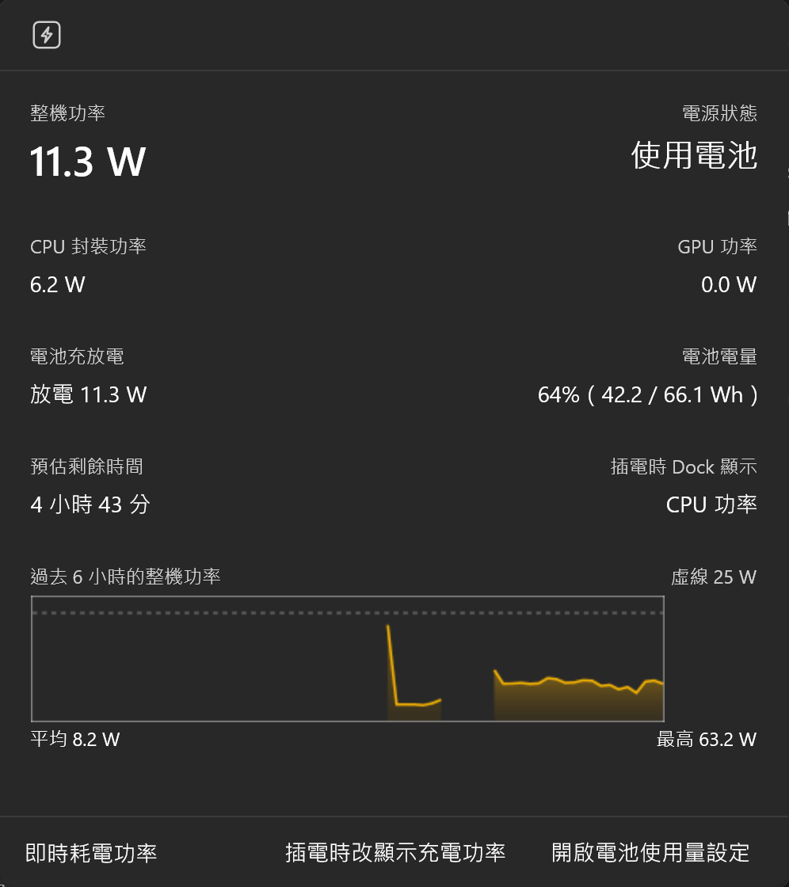

# Command Palette PowerMeterBand

在 [PowerToys Command Palette](https://learn.microsoft.com/windows/powertoys/command-palette/overview) 的 Dock 上，即時顯示整台電腦目前的耗電功率，另外附即時網速、合併的 CPU／GPU／記憶體監視器、合併的日期時間，以及仿 Mac 頂欄左側的系統選單和目前 App 名稱。


## 功能

- **即時功率**：用電池時，Dock 上每秒更新整機耗電（W）。滑鼠停在上面會顯示 CPU 功率和電池充放電功率。
- **插電時可選顯示內容**：插電時量不到整機功率（見下方說明），可以在詳細資訊頁切換 Dock 要顯示**充電功率**（例如 `+42 W`；充電器供電不足、電池在補電時會顯示負值，例如 `-12 W`）或 **CPU 功率**。設定會保留。
- **詳細資訊頁**：點一下會在命令選擇區打開詳細頁面，顯示整機功率、CPU 封裝功率、GPU 功率、電池充放電、電量（Wh）和預估剩餘或充飽時間。
- **跟內建項目一致**：圖示亮度、間距、等寬數字都跟內建的效能監視器（CPU、記憶體、電池）相同，數字跳動時寬度不變。
- **佔用很少**：約 0.4% 的單一 CPU 核心、約 60 MB 記憶體。
- **即時網速**：另一個 Dock 項目，只顯示上傳或下載其中一個，可以在它的詳細資訊頁切換，設定會保留。圖示是方框裡放箭頭，跟閃電圖示同一個風格。數值算法和統計的網卡（只算實體網卡，不含 VPN 和虛擬網卡）都跟 PowerToys 內建的網速項目相同；Dock 上把 `Kbps` 簡寫成 `Kb`（例如 `30.5 Kb`），寬度跟其他項目差不多，詳細頁仍顯示完整單位。
- **CPU／GPU／記憶體**：把內建效能監視器的三格合成一格，Dock 上只顯示其中一個（在詳細頁切換，圖示也跟著換成內建的那個，設定會保留）。數值算法跟內建的一樣。詳細頁一次列出三者，各有跟內建相同配色的圖表，以及：
  - CPU：型號與核心數、使用率、速度、溫度
  - GPU：型號、使用率、溫度
  - 記憶體：容量、類型、速度與廠牌、使用率、使用中、總量、已認可、已快取

  溫度是主機板回報的處理器晶片溫度（ACPI 熱區 TZ00，或名稱標明 CPU 的熱區，不需要管理員權限），會跟著負載變化，但不是每顆核心的精確溫度。沒有這類熱區時顯示 `--`，不拿機殼等其他熱區充數；開機後感測器較晚就緒時，每 30 秒會再找一次。讀不到的數值在圖表上留白，不畫成 0%。Windows 沒有提供 GPU 的溫度感測器；只有內顯時，GPU 那欄顯示同一個熱區的溫度並標明「ACPI 參考溫度，非 GPU 感測器」（Intel Core Ultra 的內顯在獨立的 Graphics Tile 上，實際溫度可能不同）。記憶體沒有溫度感測器。
- **電池**：取代內建的電池項目。內建的跟命令選擇區一起載入，比擴充功能早，重開時會先單獨出現在 Dock 上；換成這個之後，右邊的項目會一起出現。Dock 上的圖示完全照內建的做法：同樣用 `GetSystemPowerStatus` 讀電量，依電量四捨五入成 11 格的電池字形，充電中換成帶插頭的那組，讀不到電池時顯示問號電池。百分比直接用 Windows 給的整數（內建的換算方式會把 53%、59% 顯示成 52%、58%）。只有 Windows 明確說沒有電池才顯示「沒有電池」；電量或電源狀態讀不到時顯示 `--`，不會猜成沒有電池或使用電池。滑鼠停在上面會顯示狀態和剩餘或充飽時間。電池數值變得很慢，所以不跟其他項目每秒更新：插拔電源、開始或停止充電、電量改變時，Windows 一通知就立刻更新，其餘（充放電功率、剩餘時間）每 30 秒更新。詳細頁有電量、狀態（充電中、接上電源、使用電池）、預估剩餘或充飽時間（跟耗電詳細頁同一個算法）、充放電功率、目前容量，以及電池健康度（充飽容量和出廠設計容量的比例）。
- **日期與時間**：把內建分開的日期、時間合成一格，照 Mac 頂欄的樣子顯示星期、上午或下午和時間，例如 `週二 下午 8:35`。點一下打開詳細頁：秒數、完整日期、農曆（含干支和生肖）、第幾週、今年第幾天和還剩幾天、時區、地區（Windows 地區設定的國家，不需要定位權限）、24 小時制和世界標準時間；下方有日期和時間設定、通知中心與月曆、時鐘 App 的捷徑。每秒檢查一次，睡眠喚醒或調整時間後很快就會更新。
- **系統選單**（仿 Mac 的蘋果選單）：只有一個 Windows 圖示，點開有關於這台電腦、系統設定、Microsoft Store、強制結束（工作管理員）、睡眠、重新啟動、關機、鎖定畫面、登出。重新啟動、關機、登出會先確認。建議在 Dock 設定裡關掉這個項目的標題，只留圖示。
- **目前 App 名稱與選單**（仿 Mac 頂欄左側）：顯示前景程式的名稱，後面接著「檔案」「編輯」「視窗」三個選單。切換程式時立刻更新。像 Mac 一樣，只有真的回到桌面才顯示「桌面」：雙擊桌面捷徑開 App 時，新 App 打開前會繼續顯示原本的 App（Windows 顯示「程式啟動中」游標的期間會一直等，最多 20 秒），只是點桌面的話一兩秒後才換成「桌面」；按叉叉關掉視窗、Windows 把前景丟給桌面時，改顯示畫面上最上層的 App，沒有任何 App 視窗才顯示「桌面」；點系統匣圖示叫出的小視窗、Dock 的選單關閉後焦點掉到桌面（滑鼠不在桌面上）時，也不會變成「桌面」。點系統匣圖示也不會換成那個圖示的程式，跟 Mac 頂欄右邊的小圖示一樣：看不見的視窗一律不算換程式（很多程式跳出選單前會先把前景交給自己的隱藏視窗）；從工作列或系統匣點出來、沒有標題列又不到螢幕四分之一大的小視窗也不算（最多忽略 30 秒）。真正打開有標題列的 App 視窗時才會換過去。點工作列、開始功能表或 Dock 本身時不會跳動；截圖畫面（`Win+Shift+S`）、Click to Do 這類暫時蓋在畫面上的視窗也不算換程式，所以截圖時頂欄仍顯示原本的 App。滑鼠停在名稱上會顯示目前視窗的標題。主要靠系統的視窗通知更新；有些程式（例如 Electron 做的）換前景時通知會漏發或亂發，所以每秒再對一次系統的前景視窗，前景明顯是另一個程式時就跟過去。Store App 剛啟動、外框裡的程式還沒接上時，只顯示名稱、不提供選單（那時的程序是所有 Store App 共用的外框），接上後一秒內換成它自己的選單。選單裡的動作都是關掉選單後才執行，執行前會先確認那個視窗還在、仍屬於原本的程式（Windows 會把關掉的視窗代碼給新視窗用），不是就不動作。
  - **App 名稱**：記憶體（跟工作管理員一樣是私人工作集，瀏覽器這類多程序的 App 會加總）、CPU 使用率、視窗數；開新視窗、隱藏其他 App、隱藏、結束（會讓程式詢問是否存檔），以及沒有回應時用的強制結束（會先確認；確認時會核對程序的啟動時間，程式已經結束、編號被別的程式用掉時不會誤殺；檔案總管不提供，以免連工作列一起關掉）
  - **檔案**：新增、開啟舊檔、儲存、列印、關閉視窗
  - **編輯**：復原、剪下、複製、貼上、全選、尋找，以及剪貼簿記錄、表情符號與符號、螢幕擷取
  - **視窗**：貼齊左半邊、貼齊右半邊、最大化或還原、保持在最上層、最小化，以及這個程式所有開著的視窗（點一下切換過去）

  選單會依程式不同：
  - **有傳統選單列的程式**（Windows 傳真和掃描、系統資訊、MMC 主控台等）：直接顯示它自己的選單，項目和灰色、打勾狀態都跟程式裡一樣，點了就執行；整個選單停用、或程式開著對話框（主視窗被停用）時，裡面的項目也不能點。打開選單時會照真的開選單那樣先通知程式（`WM_INITMENU`、`WM_INITMENUPOPUP`），讓它更新項目狀態；點下去的那一刻會再確認一次項目還在、沒被停用，程式改過選單就不執行。Tk 這類自己畫選單的程式讀不到項目，會改成「在程式裡打開這個選單」。
  - **以系統管理員身分執行的程式**（登錄編輯程式、工作管理員）：只顯示名稱。Windows 不讓一般程式對它們送按鍵或選單指令，顯示選單也按不動。
  - **常用 App 的專屬選單**（只用各 App 官方的快捷鍵）：
    - Chrome、Edge、三星瀏覽器：檢視、歷史記錄、書籤、分頁
    - 檔案總管：檢視（各種圖示大小、預覽窗格）、導覽（上一頁、上一層、桌面、下載、文件…）
    - VS Code：檢視、導覽
    - Word、PowerPoint：插入、格式；PowerPoint 另有投影片放映；Excel：插入、格式、資料
    - Spotify：播放（播放／暫停、上下首、隨機、重複、音量）
    - Discord：導覽（快速切換、頻道、伺服器）、通話（靜音、拒聽）
    - OneNote：檢視、導覽、格式；Outlook（新版和傳統版）：郵件、導覽
    - 終端機：檢視；「檔案」「編輯」改用 `Ctrl+Shift` 的版本，因為一般的 `Ctrl+C`、`Ctrl+Z` 會傳給 shell
    - GitHub Desktop：儲存庫（推送、拉取、擷取）、分支、檢視；Postman：請求、檢視；Obsidian：檢視、導覽、格式
    - 記事本：檢視，以及取代、移至行；Teams：導覽、會議；相片：影像、檢視；媒體播放器：播放、檢視；小畫家：影像、檢視
    - Claude、ChatGPT：會話、檢視、導覽
    - 剪取工具：截圖；VirtualBox 管理員：機器、工具（它的 Ctrl+O 是複製虛擬機器、Ctrl+A 是加入虛擬機器，所以沒有通用的檔案、編輯）；手機連結：導覽、手機、通話
    - Git Bash（mintty）：檢視（字型縮放、預設大小、全螢幕）、終端機（下一個視窗、重設）；「編輯」用 mintty 預設的 `Ctrl+Insert` 複製、`Shift+Insert` 貼上和 `Alt+F3` 搜尋，不送會中斷程式的 `Ctrl+C`；「檔案」只有開新視窗，因為關掉會結束 shell
    - 舊式主控台（不在終端機裡的命令提示字元、PowerShell）：只有「編輯」，用主控台自己的系統選單指令（標記、複製、貼上、全選、捲動、尋找、內容），完全不送按鍵，避免誤按 Ctrl+C 中斷程式；也沒有「關閉視窗」，因為關掉會直接結束裡面的程式
    - LINE：導覽、聊天、格式、通話（依 LINE 設定裡的「快捷鍵」頁）；「檔案」換成 LINE 自己的版本，因為它的 Ctrl+O 是把檔案傳到目前聊天、Ctrl+P 是截圖
    - Docker Desktop：檢視（搜尋、終端機、縮放）；「檔案」只有設定和關閉視窗（只關掉主畫面，容器照跑）。它的 `Ctrl+Q` 會直接結束整個 Docker，連執行中的容器一起停，所以不放
    - Microsoft Store：導覽（首頁、媒體櫃與更新、設定），用 Store 自己的連結開啟；Store 沒有自己的快捷鍵，關閉也只會縮到最小，所以沒有「檔案」
    - 小算盤：記憶、檢視；「檔案」只有關閉視窗，「編輯」只有複製和貼上，因為它的 `Ctrl+N`、`Ctrl+O`、`Ctrl+S` 會算 e^x、cosh、sinh，`Ctrl+P` 會改記憶
    - Samsung Notes：格式、檢視、工具（依 App 內按 F1 的快捷鍵清單）；列印是 `Ctrl+Shift+P`，筆記開著時 `Ctrl+N` 是新增頁面
    - 三星媒體瀏覽器：相片、檢視；它的 `Ctrl+N` 是用選取的項目做影片、`Ctrl+V` 會把檔案複製進目前的相簿，所以「檔案」「編輯」是它自己的版本
    - 設定類 App（Windows 設定、PowerToys 設定、Samsung Settings、Quick Share、SmartThings、Samsung Pass、Device Care、Multi Control、附近裝置、Intel 顯示卡軟體、意見反應中樞）：沒有東西可開啟或儲存，「檔案」只有關閉視窗；PowerToys 設定和 Multi Control 另有「上一頁」

    很多 App 的一般快捷鍵另有意思，例如 Spotify 的 `Ctrl+S` 是隨機播放、Discord 和 Obsidian 的 `Ctrl+P` 是釘選訊息和命令面板、GitHub Desktop 的 `Ctrl+P` 是推送、媒體播放器的 `Ctrl+F` 是下一首、Outlook 的 `Ctrl+F` 是轉寄。這些 App 的「檔案」「編輯」都換成了它們自己的版本，或拿掉會做錯事的項目。
  - **其他程式**：檔案、編輯、視窗。

  Windows 的程式不會像 Mac 一樣把自己的選單交給頂欄，所以除了傳統選單列，「檔案」「編輯」和專屬選單都是幫你在那個程式裡按下快捷鍵（項目旁邊會標出來）。只放各程式意思都一樣的快捷鍵；重做、縮放、重新整理這類在某些程式意思不同的（例如 Word 的 `Ctrl+=` 是下標、PowerPoint 的 `F5` 是放映）都不放。少數程式不支援某個快捷鍵時，按了只是沒反應；VS Code 不顯示「列印」（它的 `Ctrl+P` 是快速開啟），Outlook 不顯示「尋找」（它的 `Ctrl+F` 是轉寄）。按鍵前會先確認那個程式已經回到最前面，否則不按，以免按到別的視窗。

  在命令選擇區的清單裡，點一下是選取，按兩下或按 Enter 才會執行。



## 資料來源

| 項目 | 來源 |
|---|---|
| 整機功率 | Windows 效能計數器 `\Power Meter(Power Meter (0))\Power`（ACPI 電源計量器）。沒有這個計數器時，改用電池放電功率 |
| CPU 封裝功率 | `\Energy Meter(RAPL_Package0_PKG)\Power`（Intel RAPL） |
| GPU 功率 | `\Energy Meter(RAPL_Package0_PP1)\Power`（Intel RAPL 內顯電源平面） |
| 電池 | `Windows.Devices.Power.Battery` |
| 網速 | `GetIfTable2` 的實體網卡收發位元組數，每秒相減 |
| CPU | `Processor Information(_Total)` 的 `% Processor Time`；速度是 `Processor Frequency` × `% Processor Performance` |
| GPU | `GPU Engine(*)` 的 `Utilization Percentage`，同一引擎跨程序加總、取最忙的引擎（3D、影片解碼等都算，跟工作管理員一樣）。用一個一直開著的 PDH 查詢讀取，不必每秒重讀整個類別 |
| 記憶體 | `GlobalMemoryStatusEx`，以及 `Memory` 的 `Committed Bytes`、`Commit Limit`、`Cache Bytes` |
| 溫度 | `Thermal Zone Information(\_TZ.TZ00)`（或名稱含 CPU 的熱區）的 `High Precision Temperature` |
| 硬體名稱 | 登錄檔的 `ProcessorNameString`，以及 WMI 的 `Win32_Processor`、`Win32_VideoController`、`Win32_PhysicalMemory` |
| 目前 App | `SetWinEventHook(EVENT_SYSTEM_FOREGROUND)`；名稱取自 Store App 在開始功能表的名稱，或程式檔的檔案描述 |

ACPI 電源計量器量的是「從電池流出的電」，**插電時讀數是 0**，筆電也沒有其他感測器能量整機用電，所以整機功率只在使用電池時有數值。

不是每台電腦都有 Power Meter 計數器，可以先用 PowerShell 檢查：

```powershell
Get-Counter '\Power Meter(*)\Power', '\Energy Meter(*)\Power'
```

## 需求

- Windows 11 x64
- PowerToys，並在命令選擇區設定中啟用 Dock
- [.NET 10 SDK](https://dotnet.microsoft.com/download)：`winget install Microsoft.DotNet.SDK.10`

不需要 Visual Studio，也不需要 Windows SDK 或開發人員模式。打包工具會由腳本自動從 NuGet 下載，安裝的是簽章過的 MSIX。

已知問題：PowerToys 預覽版的 Dock 在精簡尺寸下，每次啟動會隨機把整排文字畫低約 1.5 點，偶爾只有其中一格偏低，而且那一格會隨著選單切換換位置。內建項目（例如時鐘）也一樣，問題出在 Dock 本身，擴充功能改不到；重新開啟命令選擇區通常就會恢復。另外，Dock 的彈出清單開著時，點另一個項目要點兩次：第一下只會關掉目前的清單。那是 PowerToys 用的 WinUI `Flyout` 點外面就關閉、並吃掉那一下點擊（PowerToys 沒設定 `OverlayInputPassThroughElement`），同樣只能由 PowerToys 修正。

## 建置與安裝

1. 把專案 clone 到**路徑不含中文等非 ASCII 字元**的資料夾，例如 `D:\PowerMeterBand`。CsWinRT 在含中文的路徑下會編譯失敗。
2. 打開 `src/AppxManifest.xml`，把 `<Identity>` 的 `Publisher="CN=Terry"` 改成你自己的名稱（例如 `CN=YourName`），`PublisherDisplayName` 也一起改。
3. 第一次執行時加上 `-NewCert`，腳本會建立一張跟 Publisher 同名的自簽憑證：

   ```powershell
   .\src\build-and-install.ps1 -Version 1.0.0.0 -NewCert
   ```

4. 用**系統管理員身分**執行腳本最後印出的 `Import-Certificate ...` 指令，讓 Windows 信任這張憑證（只需要做一次）。
5. 再執行一次，就會編譯、打包、簽章並安裝：

   ```powershell
   .\src\build-and-install.ps1 -Version 1.0.0.0
   ```

6. 把它加到 Dock：在命令選擇區搜尋「即時耗電功率」或「即時網速」，使用「Pin to Dock」；也可以進入 Dock 的編輯模式，用「Add band」加入（系統選單和目前 App 名稱只能用這個方法加入）。

之後修改程式碼，只要用**更大的版本號**再執行一次腳本就能更新，例如 `-Version 1.0.1.0`。版本號沒有比已安裝的大，腳本會直接擋下來。

## 專案結構

```
src/
  PowerSampler.cs              讀取功率與電池資料
  PowerDockBand.cs             Dock 上的項目（每秒更新）
  PowerDetailsPage.cs          點擊後的詳細資訊頁（Adaptive Card）
  PluggedInDisplay.cs          插電時顯示內容的設定與切換按鈕
  NetSpeedSampler.cs           讀取網卡流量、換算網速
  NetSpeedDockBand.cs          Dock 上的網速項目（每秒更新）
  NetSpeedDetailsPage.cs       網速的詳細資訊頁
  NetSpeedDirection.cs         顯示上傳或下載的設定與切換按鈕
  SystemMenu.cs                系統選單（Windows 圖示）
  ActiveApp.cs                 目前 App 名稱：追蹤前景視窗
  ActiveAppPage.cs             點 App 名稱後的選單：用量、開新視窗、隱藏和結束
  AppMenus.cs                  檔案、編輯、視窗選單，以及送出快捷鍵
  AppMenuCatalog.cs            常用 App 的專屬選單
  ClassicMenu.cs               讀取並執行傳統選單列
  SystemMonitor.cs             CPU／GPU／記憶體取樣、溫度、硬體名稱、圖表
  SystemMonitorBand.cs         合併的 CPU／GPU／記憶體 Dock 項目與詳細頁
  ClockBand.cs                 合併的日期時間與詳細頁
  BatteryBand.cs               電池項目（取代內建）與詳細頁
  DockValueListItem.cs         固定標籤寬度、等寬數字
  PowerMeterCommandsProvider.cs / PowerMeterExtension.cs / Program.cs
                               Command Palette 擴充套件的進入點
  AppxManifest.xml             MSIX 套件資訊
  Assets/                      圖示（閃電、上下箭頭和 Windows 標誌 SVG，各分深色、淺色兩版）
  build-and-install.ps1        編譯 → 打包 → 簽章 → 安裝
```

## 授權

[MIT](LICENSE)
